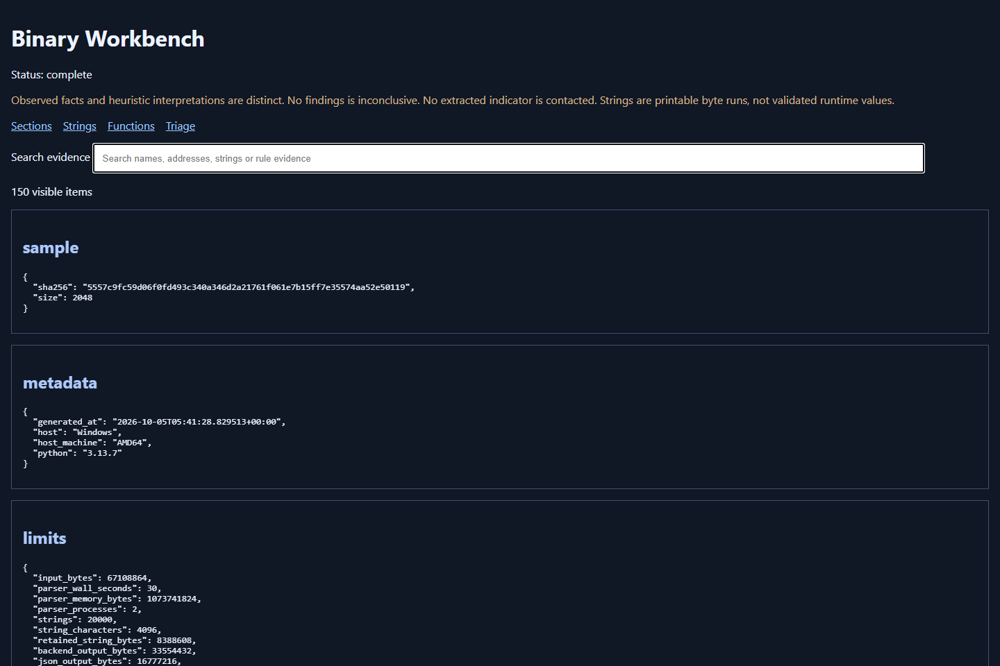
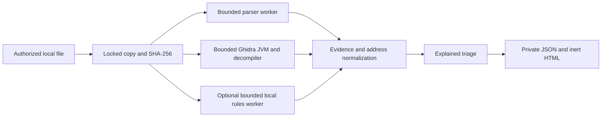

# Binary Analysis Workbench

A local Windows workbench that connects **static PE/ELF evidence, real Ghidra disassembly/decompilation, and explained malware-triage observations**. It provides a CLI, searchable self-contained HTML, and versioned JSON. It never executes submitted binaries or contacts extracted indicators.

This portfolio project makes the orchestration, evidence model, resource controls and investigation workflow the original contribution. pefile/pyelftools parse formats, Ghidra analyzes machine code, and optional YARA-X matches explicitly supplied local rules. Analysis needs no account, cloud API, paid service or LLM.

## Demonstration

The [reviewed harmless PE64 HTML report](examples/benign-pe64/report.html) and [JSON report](examples/benign-pe64/report.json) show the complete workflow. Search `BINARY_WORKBENCH_BENIGN_FIXTURE`, select `string_fixture`, and follow its string-reference links. The harmless marker rule matches a documented file offset. Embedded HTML renders as text.



Four source-built fixtures passed real reverse engineering: PE32/x86, PE32+/x64, ELF32/x86 and ELF64/x64. Each produced three selected functions, instructions, references, CFGs and nonempty pseudocode. Instruction bytes, headers, hashes, marker offsets and rule matches were checked against independent fixture expectations. Stripped/optimized recovery and PE import-reference navigation also passed. See [verification](docs/verification.md) and the example's aggregate verification records.

## Supported matrix

| Area | Verified support | Limits |
|---|---|---|
| Host | Windows x64; CPython 3.13.7 | Other hosts and 32-bit Python unsupported |
| PE | Native x86/x64 headers, sections, imports/delay imports, exports, COFF symbols when present, resources, certificate directory and trailing bytes | Managed CLR/other architectures receive static evidence and unsupported RE; signatures/certificates are not trust validation |
| ELF | Little-endian x86/x64 EXEC/DYN, segments, sections, symbols, dynamic dependencies, PIE, stripped/sectionless evidence | No runtime PIE base or eager DWARF/external debug-file loading |
| RE | Ghidra 12.1.4, trusted JDK 21; selected names or addresses | Approximate pseudocode; inferred names/boundaries; discovery and indirect references may be incomplete |
| Strings | ASCII and UTF-16LE with offsets, including terminated printable BMP Unicode at both alignments | Surrogate-pair/non-BMP wide strings are not decoded; printable runs do not establish intended boundaries |
| Triage | Permissions, entropy, import combinations, entry mappings, inert indicators, explicit local rule matches | No verdict, probability, behavioral proof or assertion of safety |
| Presentation | CLI, schema 1.0.0 JSON, bundled searchable HTML | Output caps; file-URL browser automation was unavailable, so browser verification used loopback then offline interaction |

## Setup

Run these PowerShell commands **from this project directory** with a trusted Windows x64 Python 3.13 installation. Only setup requires fetching reviewed packages/tools; runtime analysis is local.

```powershell
python -m venv .venv
.venv/Scripts/python.exe -m pip install --require-hashes -r requirements.lock
.venv/Scripts/python.exe scripts/dev.py doctor
```

The full lock includes the optional signature engine. For static-only installations, use `requirements-core.lock`; add `requirements-signatures.lock` when needed. The locks select reviewed Windows-compatible artifacts, not every platform wheel.

For RE, obtain **Ghidra 12.1.4** and **Temurin JDK 21.0.12.1+1** from their official release links in [setup](docs/setup.md). Verify the exact archives against [toolchain.lock.json](toolchain.lock.json) before extraction. The already prepared local development environment has `.tools/paths.json`. On another machine create a trusted JSON file such as:

```json
{
  "ghidra": "C:/Tools/ghidra_12.1.4_PUBLIC",
  "java": "C:/Tools/jdk-21.0.12.1+1/bin/java.exe"
}
```

Do not point this configuration at a submitted sample. The workbench launches that executable as trusted tool code. `doctor --tools-config FILE` inventories packages and existing paths; it does not certify tool integrity or a complete sandbox.

## Analyze and investigate

Only analyze files you own or are authorized to inspect. For genuinely hostile samples, use a disposable **offline Windows VM** with host shares/clipboard disabled. Job Objects enforce worker resource/lifetime limits, not malware isolation.

```powershell
.venv/Scripts/python.exe scripts/dev.py analyze C:/Lab/authorized-file.exe `
  --tools-config .tools/paths.json `
  --select branch_fixture,string_fixture `
  --rules rules/benign-demo.yar

.venv/Scripts/python.exe scripts/dev.py functions C:/PRIVATE-RUN/report.json
.venv/Scripts/python.exe scripts/dev.py inspect C:/PRIVATE-RUN/report.json string_fixture
.venv/Scripts/python.exe scripts/dev.py inspect C:/PRIVATE-RUN/report.json 0x140001030
.venv/Scripts/python.exe scripts/dev.py export C:/PRIVATE-RUN/report.json
```

Each analysis creates a unique protected run under `%LOCALAPPDATA%/BinaryWorkbench/runs`, canonicalized to the physical path when Windows app packaging redirects AppData. The CLI prints report paths and JSON-escaped summaries. Original files stay unchanged; all workers read the same deny-write/delete snapshot. Reports omit the original filename/path. Private diagnostic files and raw backend artifacts remain in the private run.

Use `--static-only` to explicitly skip RE. Without it, absent/unconfigured RE yields a partial report with the missing check stated. `--select` accepts comma-separated exact function names or one hexadecimal address; the default decompiles the first three discovered functions. An index entry without detail requires re-analysis with a selection. Follow references in HTML or use the structured `evidence_ids` in JSON. `[IMPORTED]` name provenance represents recovered symbols; `DEFAULT` names are inferred. Every boundary is marked `ghidra_analysis`.

Local signature rules are UTF-8 files, capped at 4 MiB. Includes are disabled; paste a reviewed rule set into one file. No automatic rules, feeds, reputation queries or uploads occur. The original demo rule identifies the harmless fixture; it is not a malware rule.

## States and exit codes

| Code | Meaning |
|---|---|
| 0 | Requested analysis complete; or inspection/export succeeded |
| 2 | Partial: a requested check unavailable/failed/timed out, malformed evidence or truncation |
| 3 | Unsupported sample format/architecture |
| 4 | Collection, mandatory containment, invalid configuration/report or report-output failure |
| 5 | Requested function/index details unavailable |
| 6 | Reserved direct timeout/output-limit status; current analyze aggregates optional failures into code 2 |

Argument syntax errors also use argparse's code 2. A report's worker status distinguishes `timeout`, `output_limit`, `failed`, `unavailable`, `unsupported`, `partial`, `complete` and deliberate `skipped`. Errors do not echo raw parser/backend exception strings. “No findings” remains inconclusive.

## Architecture and security



The core is independent of HTML/CLI presentation. The supervisor creates trusted workers suspended, installs memory/process limits and assigns them to a Job Object before resuming. It uses an explicit inherited-handle list, kills the whole tree on timeout/normal completion and verifies zero active job processes. Paths reject devices, UNC paths, alternate streams and reparse points; reports use exclusive creation. Run directories receive an owner/SYSTEM DACL atomically at creation.

Defaults match the approved plan: 64 MiB input; 30-second/1 GiB/two-process parser; 180-second/4 GiB/four-process RE worker with a 2 GiB JVM heap and 15-second per-function decompiler deadline; 15-second signature worker; 20,000 strings, 4,096 characters/string, 8 MiB retained text; 32 MiB backend payload, 16 MiB JSON, 24 MiB HTML, 1 MiB diagnostics. The sampled 256 MiB worker disk budget can overshoot. Network isolation, hard disk quotas and protection after parser compromise require the VM. [Security model](docs/security-model.md) explains the remaining gaps.

## Rebuild and verify

See [setup](docs/setup.md) for the Zig 0.14.1 configuration and hash verification, then:

```powershell
.venv/Scripts/python.exe scripts/build_fixtures.py "$env:LOCALAPPDATA/BinaryWorkbench/my-fixtures"
.venv/Scripts/python.exe scripts/build_variants.py "$env:LOCALAPPDATA/BinaryWorkbench/my-variants"
.venv/Scripts/python.exe scripts/verify_integration.py "$env:LOCALAPPDATA/BinaryWorkbench/my-fixtures"
.venv/Scripts/python.exe scripts/verify_failure_paths.py "$env:LOCALAPPDATA/BinaryWorkbench/my-fixtures" "$env:LOCALAPPDATA/BinaryWorkbench/my-variants"
```

Outputs require fresh directories. These commands compile but **never execute** their resulting samples. For tests, install the two test lock files as described in setup, set `WB_VARIANTS` to the built variants, and run `python -m pytest`. Publication/merge and GitHub-hosted checks were not authorized/run; the local `.github` scaffolding is ready for repository-specific review.

Lessons: distinguish offsets/RVAs/VAs and static/runtime bases; treat parser tolerance as uncertainty; verify actual Ghidra analyzer option names; keep reference joins bounded outside worker processes; check decompiler conclusions against instructions. [LEARNING.md](LEARNING.md), [DECISIONS.md](DECISIONS.md), [STATE.md](STATE.md) and [schema documentation](docs/schema.md) record those details.

Original code is MIT. [Third-party notices and AI-assistance disclosure](THIRD_PARTY_NOTICES.md) describe integrated components and assistance. ECC review was performed by the implementing Codex agent; it is not an independent security audit.
